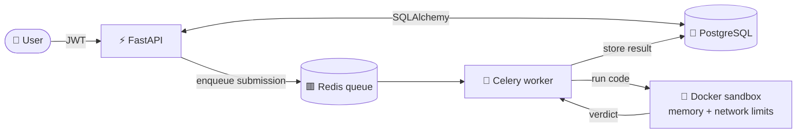

<!-- Profile README: keep this in a PUBLIC repo named exactly Ompatel75/Ompatel75 -->
<!-- TODO: replace YOUR_ATCODER_ID (3 places) with your AtCoder handle -->

<!-- ============ HEADER ============ -->
<p align="center">
  
</p>

<p align="center">
  <a href="https://github.com/Ompatel75">
    
  </a>
</p>

<p align="center">
  
  <a href="https://github.com/Ompatel75?tab=followers"></a>
</p>

<p align="center">
  <a href="https://codeforces.com/profile/Omm_Patel"></a>
  <a href="https://leetcode.com/u/om_patel11/"></a>
  <a href="https://www.codechef.com/users/om_patel_007"></a>
  <a href="https://atcoder.jp/users/YOUR_ATCODER_ID"></a>
</p>

---

## 🖥️ whoami

```bash
$ whoami
om_patel  # B.Tech ICT @ DA-IICT, Gandhinagar (2024-2028)

$ cat interests.txt
graphs . dp . segment trees . async job queues . backend systems . clean code

$ ./status.sh
>> Codeforces Expert | LeetCode Knight | CodeChef 3-Star
>> 1300+ problems solved, mostly in C++
>> Building: Judgely (online judge + AI tutor)
>> Open to SWE internships
```

## 🛠️ Tech Stack

<p align="center">
  
</p>

<p align="center">
  <b>Languages</b><br/>
  
  
  
  
  <br/><br/>
  <b>Backend</b><br/>
  
  
  
  
  
  
  
  <br/><br/>
  <b>Data</b><br/>
  
  
  
  <br/><br/>
  <b>DevOps and Tools</b><br/>
  
  
  
  
  
  
  
</p>

## 🚀 Featured Project: Judgely

An online platform to solve competitive programming problems, with an **AI tutor**. Submissions are queued, executed in a locked-down Docker sandbox, and judged asynchronously.

<p>
  <a href="https://github.com/Ompatel75/Judgely"></a>
  <a href="https://judgely-1.onrender.com"></a>
</p>



<p align="center">
  <a href="https://github.com/Ompatel75/Judgely">
    
  </a>
</p>

## 🧰 More Projects

| Project | Stack | What it does |
|---|---|---|
| 📊 **CF Percentile Tracker** | JavaScript, Chrome Extension | Shows runtime and memory percentile stats right on Codeforces problem pages |
| 🏠 **StayBnB** | PostgreSQL, pgAdmin | Airbnb-inspired relational design: ER modeling, BCNF decomposition, window functions and analytics queries |
| 🧠 **AI Software Project Health & Risk Analyzer** | Python, GitHub API, GenAI | Team project (IT314): analyzes repos, issues, PRs and sprints to flag project risks |

<!-- Tip: link each project name to its repo, e.g. [StayBnB](https://github.com/Ompatel75/REPO) -->

## ⚔️ Competitive Programming

| Platform | Rank | Handle |
|---|---|---|
|  | **Expert** | [Omm_Patel](https://codeforces.com/profile/Omm_Patel) |
|  | **Knight** | [om_patel11](https://leetcode.com/u/om_patel11/) |
|  | **3 Star** | [om_patel_007](https://www.codechef.com/users/om_patel_007) |
|  | | [YOUR_ATCODER_ID](https://atcoder.jp/users/YOUR_ATCODER_ID) |

<p align="center">
  
</p>

<details>
<summary><b>🧩 Click to expand: techniques I use</b></summary>
<br/>

- **Data structures:** segment tree (lazy propagation, dynamic), DSU, Mo's algorithm, XOR linear basis, tries, heaps
- **DP:** digit DP, tree DP (rerooting, small-to-large merging), bitmask DP, meet-in-the-middle
- **Graphs:** Dijkstra variants, bridges, SCC, cycle and odd-cycle detection, spanning trees with DSU
- **Math and games:** combinatorics, Sprague-Grundy, convex polygon point-in-polygon

</details>

<details>
<summary><b>📚 Click to expand: core CS I study</b></summary>
<br/>

- **DBMS:** normalization, indexing, transactions, concurrency, CAP theorem
- **Operating Systems:** scheduling, synchronization, deadlocks, memory management, page replacement
- **OOP:** inheritance, polymorphism, virtual functions
- **Systems and more:** Docker sandboxing and security, Hadoop basics, Verilog and FPGA basics, information theory (LDPC, belief propagation)

</details>

## 📈 GitHub Stats

<p align="center">
  
  
</p>

<p align="center">
  
</p>

<p align="center">
  
</p>

## 🌌 3D Contribution Graph

<!-- Generated by profile-3d.yml -->
<p align="center">
  
</p>

## 📊 Activity


## 🐍 Contribution Snake

<!-- Generated by snake.yml -->
<picture>
  <source media="(prefers-color-scheme: dark)" srcset="https://raw.githubusercontent.com/Ompatel75/Ompatel75/output/github-snake-dark.svg" />
  <source media="(prefers-color-scheme: light)" srcset="https://raw.githubusercontent.com/Ompatel75/Ompatel75/output/github-snake.svg" />
  
</picture>

## 🤝 Let's Connect

<p align="center">
  <a href="https://github.com/Ompatel75"></a>
  <!-- <a href="https://www.linkedin.com/in/YOUR-ID"></a> -->
  <!-- <a href="mailto:YOUR-EMAIL"></a> -->
</p>

<p align="center">
  
</p>

<p align="center">
  
</p>
