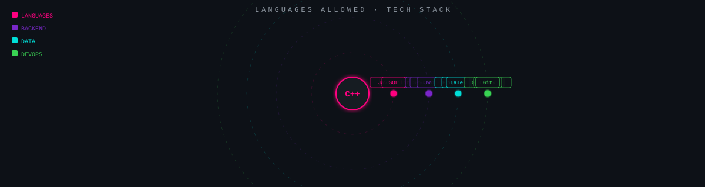
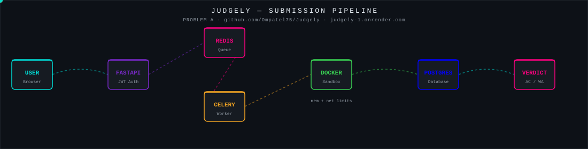
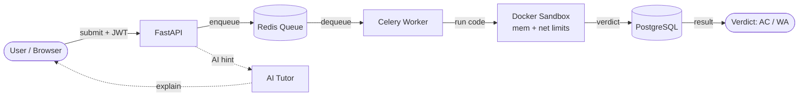
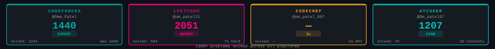
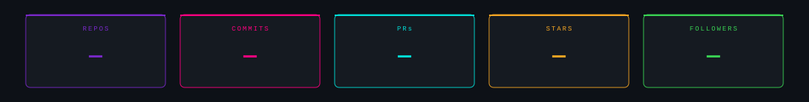

<div align="center">



</div>


<table>
<tr>
<td width="55%" valign="top">

```
┌─────────────────────────────────────────┐
│  $ whoami                               │
│  > Om Patel (@Ompatel75)                │
│                                         │
│  $ cat /etc/university                  │
│  > DA-IICT, Gandhinagar                 │
│  > B.Tech ICT · Batch 2024–2028         │
│                                         │
│  $ cat /proc/status                     │
│  > OPEN TO SWE INTERNSHIPS              │
│                                         │
│  $ cat techniques.txt                   │
│  > Lazy/Dynamic Segment Trees           │
│  > DSU · Mo's Algorithm · Digit DP      │
│  > Tree DP + Rerooting · Bitmask DP     │
│  > XOR Linear Basis · Dijkstra variants │
│  > SCC/Bridges · Sprague-Grundy         │
│                                         │
│  $ echo $STATUS                         │
│  > 1300+ problems solved ██████████ AC  │
└─────────────────────────────────────────┘
```

</td>
<td width="45%" valign="top">

**🏫 Institution**
DA-IICT — Dhirubhai Ambani University

**📚 Courses**
DBMS · OS · OOP · DSA · Info Theory · Verilog/FPGA

**⚡ Primary Language**
C++ (competitive programming)

**🔧 Backend**
FastAPI · Celery · Redis · SQLAlchemy · Pydantic · JWT

**🗄 Data**
PostgreSQL · pgAdmin · Docker · Docker Compose

**☁️ DevOps**
GitHub Actions · Render · Linux · Git · LaTeX

**🎯 Goal**
Build systems that are correct, fast and elegant — in that order.

</td>
</tr>
</table>


## 🗂 Languages Allowed

<div align="center">



</div>


## 📋 Problems — Project Submissions

<table>
<tr>
<td width="50%" valign="top">

### `[A]` Judgely &nbsp;&nbsp;

**Online Judge + AI Tutor**

```
User → FastAPI (JWT)
     → Redis queue
     → Celery worker
     → Docker sandbox ← memory + network limits
     → verdict
     → PostgreSQL
```

The AI tutor analyses your wrong answer and explains _why_ it fails — not just what the correct answer is.

🔗 [github.com/Ompatel75/Judgely](https://github.com/Ompatel75/Judgely) · [Live Demo ↗](https://judgely-1.onrender.com)

**Tech:** `FastAPI` `Celery` `Redis` `PostgreSQL` `Docker` `JWT`

</td>
<td width="50%" valign="top">

### `[B]` CF Percentile Tracker &nbsp;&nbsp;

**Chrome Extension**

Shows runtime and memory percentile directly on Codeforces problem pages. Install and forget — it just works.

- Injected content script, no background page
- Real-time percentile overlay
- Zero-config install

**Tech:** `JavaScript` `Chrome APIs` `Manifest v3`

---

### `[C]` StayBnB &nbsp;&nbsp;

**Database Design Project**

Airbnb-inspired relational schema: full ER modeling, BCNF decomposition, window functions, and complex analytics queries.

**Tech:** `PostgreSQL` `SQL` `pgAdmin`

</td>
</tr>
<tr>
<td colspan="2" valign="top">

### `[D]` AI Software Risk Analyzer &nbsp;&nbsp;

**IT314 Team Project** — Analyzes repos, issues, PRs and sprints with Generative AI to flag project health and risk signals.

**Tech:** `Python` `GitHub API` `Generative AI`

</td>
</tr>
</table>

### Problem A — Architecture

<div align="center">



</div>

<details>
<summary>📐 Mermaid fallback (text-only environments)</summary>



</details>


## 🏆 Standings

<div align="center">



</div>

<table>
<tr>
<td width="50%">



</td>
<td width="50%">



</td>
</tr>
<tr>
<td width="50%">



</td>
<td width="50%" valign="top">

```
Platform   Handle         Rank / Badge
─────────────────────────────────────
CF         Omm_Patel      Expert
LC         om_patel11     Knight
CC         om_patel_007   ★★★
AC         Om_patel07     Cyan
─────────────────────────────────────
Total                     1300+ solved
```

Techniques: Lazy seg-tree, DSU, Mo's, Digit DP,
Tree DP + rerooting, Bitmask DP, XOR basis,
Dijkstra variants, SCC/Bridges, Sprague-Grundy.

</td>
</tr>
</table>


## 🐍 CP Snake: eating my Codeforces + LeetCode + AtCoder accepted submissions (last 12 months)

<picture>
  <source media="(prefers-color-scheme: dark)"  srcset="assets/snake.svg"/>
  <source media="(prefers-color-scheme: light)" srcset="assets/snake-light.svg"/>
  
</picture>

<div align="center">
<sub>Sources: Codeforces API · LeetCode GraphQL · AtCoder Problems API · Updated daily via GitHub Actions</sub>
</div>


## 📊 GitHub Stats

<div align="center">



</div>


## 📡 Contact

<table>
<tr>
<td align="center" width="33%">

**GitHub**
[@Ompatel75](https://github.com/Ompatel75)

</td>
<td align="center" width="33%">

**LinkedIn**
`TODO — fill data/profile.json`

</td>
<td align="center" width="33%">

**Email**
`TODO — fill data/profile.json`

</td>
</tr>
</table>

> Stats refresh daily via GitHub Actions. All data is fetched live from public APIs — never invented.
> If an API is down, the last cached result is shown.

<details>
<summary>🔒 Easter Egg — click if you dare</summary>

```
$ ssh root@judge.internal

Welcome to JUDGE v2.0 — Authenticated as: Ompatel75
Last login: whenever you were procrastinating

$ cat /var/log/om_patel.log | grep "AC" | wc -l
1300

$ cat /var/log/om_patel.log | grep "WA" | wc -l
[REDACTED — too many feelings involved]

$ cat /etc/motd
┌──────────────────────────────────────────────────────────┐
│  "The first 1000 WAs are the hardest."                   │
│                                                           │
│  To the future intern-me reading this commit history:    │
│  yes, that O(n³) solution was intentional. I was         │
│  testing the time limit. It failed. I know.              │
│                                                           │
│  Anyway — if you got this far, you're either a           │
│  recruiter (hi 👋) or a fellow CP nerd.                   │
│  Either way: let's talk. The contact section is above.   │
│                                                           │
│  rating++ // skill issue resolved                        │
└──────────────────────────────────────────────────────────┘

$ exit
Connection closed.
```

</details>

<div align="center">
<sub>
Built with ❤️ and too many runtime errors · <a href="https://github.com/Ompatel75/Ompatel75/actions">Auto-updated daily</a>
</sub>
</div>
